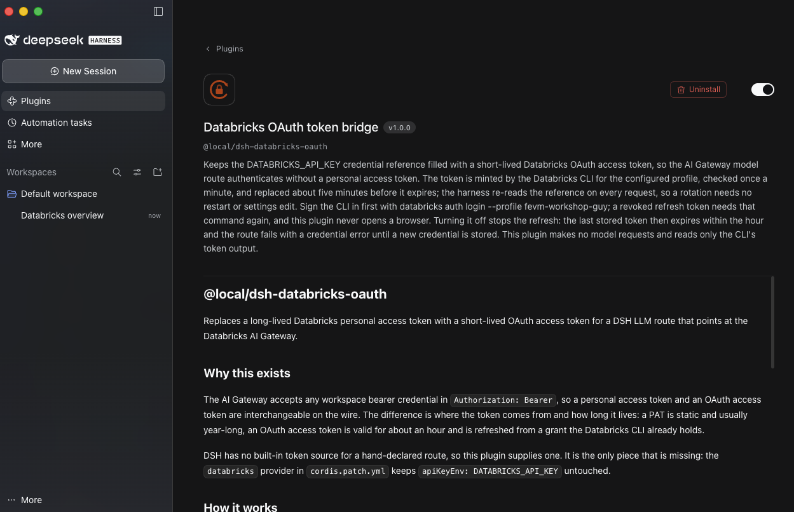

# @local/dsh-databricks-oauth

Replaces a long-lived Databricks personal access token with a short-lived OAuth
access token for a DSH LLM route that points at the Databricks AI Gateway.



## Why this exists

The AI Gateway accepts any workspace bearer credential in `Authorization:
Bearer`, so a personal access token and an OAuth access token are
interchangeable on the wire. The difference is where the token comes from and
how long it lives: a PAT is static and usually year-long, an OAuth access token
is valid for about an hour and is refreshed from a grant the Databricks CLI
already holds.

DSH has no built-in token source for a hand-declared route, so this plugin
supplies one. It is the only piece that is missing: the `databricks` provider in
`cordis.patch.yml` keeps `apiKeyEnv: DATABRICKS_API_KEY` untouched.

## Install

### Before you start

- **DeepSeek Harness 0.2.2 or newer.** The bundle declares
  `engines.dsh: ">=0.2.2-rc.3 <0.3.0"`, so an older build, or a 0.3 build, is
  refused while installing instead of failing at request time. It also needs the
  `credentials` and `timer` services, which every base-backed profile mounts.
- **A signed-in Databricks CLI.** Run `databricks auth login --profile
  <profile>` once; the plugin never opens a browser and cannot renew a revoked
  refresh token.
- **A model route** whose `baseURL` is your workspace's AI Gateway and whose
  `apiKeyEnv` names the credential reference this plugin fills.

### 1. Add the bundle

**Plugins → Add plugin** accepts a package name, Git address, tarball, or
absolute local path:

```
github:bcheng004/dsh-databricks-oauth
```

The same install from a shell, pinned to a commit so DSH can offer **Update**
later — a branch or tag spec is not updatable:

```sh
dsh plugin --profile <profile-name> add github:bcheng004/dsh-databricks-oauth#86d00de2bd0d11ce48d9c5effc4505d1db45e53f
```

A local clone added through **Add plugin** with its absolute directory works too,
and keeps edits live through the resulting `link:` dependency.

### 2. Configure it for your workspace

The bundle ships no machine-specific values, so name yours in your own profile's
`cordis.patch.yml`. An override replaces the row's complete configuration, so
list every field you need:

```yaml
- id: databricks-oauth
  name: '@local/dsh-databricks-oauth'
  config:
    profile: my-workspace            # ~/.databrickscfg profile of the route's workspace
    cliPath: /opt/homebrew/bin/databricks
    ref: DATABRICKS_API_KEY          # must equal the route's apiKeyEnv
```

The two that almost always differ are `profile` — a wrong value silently mints
tokens for the wrong workspace — and `cliPath`, because a GUI-launched app has a
minimal `PATH` and does not resolve a bare `databricks`. Intel Macs use
`/usr/local/bin/databricks`.

### 3. Verify it minted a token

The credential store (`~/.dsh/.credentials.yaml`, mode 600) should hold a JWT
under `refs.<your ref>` whose `exp` is about an hour out:

```sh
databricks auth token -p <profile> -o json | jq -r .expiry
```

Then send one message. An empty reference fails as `MISSING_CREDENTIAL` (nothing
stored) rather than as an authentication error, and a token from the wrong
workspace fails authentication instead — the two point at different mistakes.

### Notes for a shared deployment

- **Every user needs their own login.** The plugin drives U2M only; the CLI's
  `auth token` does not support M2M, so a headless or team-wide deployment needs
  the service-principal variant instead of this bundle.
- **`@local/` is a placeholder package name**, not a published scope. It works
  from a Git install; publishing to npm would mean renaming the package and the
  row reference together.

## How it works

Every `checkIntervalMs` the plugin decides whether the stored token is close
enough to expiry to be replaced. Until then it does nothing — no process is
spawned. Inside the refresh window it asks the CLI for a token:

```sh
databricks auth token -p <profile> -o json --force-refresh
```

`cliPath` decides which binary runs; the `-p` flag is omitted when no profile is
configured.

`--force-refresh` matters. The CLI serves its cached access token while that
token is still valid, so a plain call inside the window would hand back the very
token that is about to expire. The flag performs the refresh-token grant
instead, which is what keeps the store ahead of expiry rather than one poll
interval behind it.

When the returned token differs from the cached one, the plugin calls
`ctx.credentials.set(ref, token)`. The LLM adapter resolves `apiKeyEnv` per
request through that seam, so the next model call uses the new token with no
restart and no configuration edit.

### Working alongside other plugins

Activation completes only after the first mint attempt settles, so a plugin that
loads later in the bundle order and connects at startup with the same reference
starts against a token minted now, not one the previous session left behind.
This matters for MCP rows, which connect during composition rather than on first
use.

A failure in that first attempt is logged, not thrown: rejecting activation
would remove the only thing able to repair the credential.

Consumers pick up later rotations in one of two ways, and both work:

- **Per request** — a plugin that resolves the reference on each call (as the
  Genie One `genie_answer` tool does) simply uses the new value next time.
- **Per connection** — the MCP client rebuilds its connection when a resolved
  `${credential:REF}` header changes, so a rotated token reconnects rather than
  leaving a dead session. Give such a row a reconnect budget that outlasts a
  slow refresh.

A failed mint leaves the stored credential exactly as it is. Deleting the
reference instead would turn a temporary CLI outage into `MISSING_CREDENTIAL`
for every request; a token that merely expired fails only until the CLI
recovers.

## Configuration

| Key | Default | Meaning |
|---|---|---|
| `cliPath` | empty | Absolute path to the CLI. Empty resolves `databricks` through `PATH`, which a GUI-launched app does not have, so Desktop installs should set it; a configured path that no longer exists falls back to `PATH`. |
| `profile` | empty | `~/.databrickscfg` profile, which fixes the workspace and must match the host of the route's `baseURL`. Empty lets the CLI choose (`DATABRICKS_CONFIG_PROFILE`, else `DEFAULT`). |
| `ref` | `DATABRICKS_API_KEY` | Credential reference the route's `apiKeyEnv` names. |
| `refreshSkewMs` | `300000` | Mint again when the stored token is this close to expiry. |
| `checkIntervalMs` | `60000` | How often to consider refreshing. |
| `timeoutMs` | `20000` | Kill the CLI child after this long. |

## Requirements and limitations

- The Databricks CLI must be installed and signed in to `profile`; sign in with
  `databricks auth login --profile <profile>`. The plugin never opens a browser
  and cannot renew a revoked refresh token.
- Leaving `profile` empty delegates to the CLI, which uses
  `DATABRICKS_CONFIG_PROFILE`, else `DEFAULT`. That works only while the default
  profile's refresh token is valid; otherwise each attempt fails with the CLI's
  own `UNAUTHENTICATED` message, which the plugin logs while leaving the stored
  credential untouched.
- The CLI keeps its token cache in plaintext (`~/.databricks/token-cache.json`).
- The stored token is a real credential in `~/.dsh/.credentials.yaml` (mode
  600) and rotates hourly; it is not written to any configuration file.
- Calls are attributed to the signed-in user, so gateway permissions, quota and
  billing follow that identity.
- The refresh schedule is checked once a minute. The CLI runs at activation and
  inside the refresh window, not while the cached token is fresh and not on
  every model request.
- `--force-refresh` rotates the CLI's refresh token as well as the access token
  and therefore has to persist `~/.databricks/token-cache.json`. If that write
  fails the command fails, the plugin keeps the previous credential, and the
  next attempt is a minute later. A refresh token that the identity provider
  rotated but the CLI could not store needs `databricks auth login` again.
- The CLI's `expires_in` is the token's total lifetime, not the time remaining;
  only `expiry` is usable for scheduling, which is why the plugin reads it
  first and falls back to a short assumed lifetime rather than to `expires_in`.

## Turning it off

Disable or remove the plugin in **Plugins**. The last stored token stays in the
credential store and expires within the hour. To keep working afterwards, store
a credential under the same reference again — the original personal access
token, or a service-principal token. To pause refreshing without removing the
bundle, raise `checkIntervalMs` past the remaining lifetime of the stored token.

Restarting the app is not needed while the plugin is enabled: a session that
starts within the first second or so of application launch may still read the
token left by the previous run, which is why a machine that was asleep for more
than an hour can show one stale-credential failure before the first refresh
lands.
